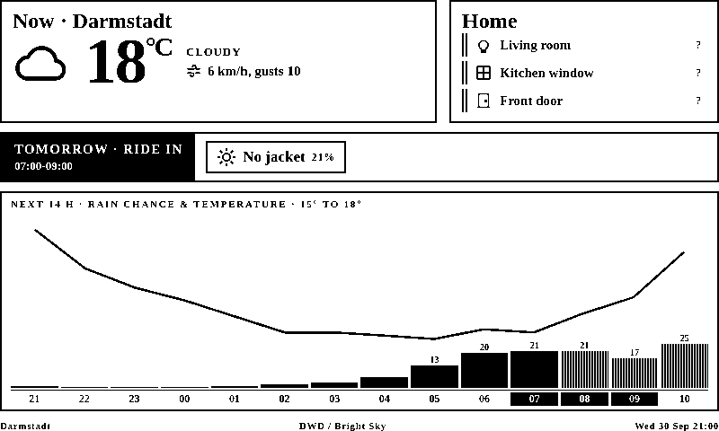

# E-ink picture frame — Home Assistant + DWD weather

A DIY e-ink dashboard: an ESP32-C3 Super Mini soldered to a Waveshare 7.5" V2
(800×480, black & white) panel, mounted in a picture frame. It shows the state
of a handful of Home Assistant entities and enough DWD weather to answer the
one question worth asking on the way out the door:

**Is it going to rain next time I step outside?**



## To do

- [ ] **Weather cache ignores a location change.** The cache keys in
      `renderer/app/weather.py` do not include the coordinates, so after
      editing `location:` the old station keeps showing for up to
      `cache.weather_seconds`. Workaround: restart the service.
- [ ] **No tests.** `next_outing` rolling over to tomorrow, the
      `If-None-Match` parsing and the `rows_entity` parsing are all cheap to
      cover and all break the frame quietly.
- [ ] **Installer update path is unproven.** The fixes for re-running
      `install-in-container.sh` on an existing container (repository
      ownership, restart instead of start) have not yet been through a full
      update on a real one.
- [ ] **Only the HOME rows come from Home Assistant.** The same `rows_entity`
      mechanism could feed extra verdict chips or a panel title.
- [ ] **Repository name.** Still `trmnl-picture-frame` from the abandoned
      TRMNL attempt; a rename means updating the URLs in `deploy/` and the
      docs.

## The idea: a dumb device and a smart server

The ESP32 downloads one 1-bit BMP over HTTP and blits it. That is all it does.
No layout, no fonts, no drawing primitives, no deep sleep.

Everything that decides what the frame *looks* like lives in a small service
that renders HTML and CSS in a headless Chromium and flattens the screenshot to
one bit per pixel:

```
Proxmox host ── frame-renderer (LXC or Docker, :8080)
                  ├─ Home Assistant states   REST API + long-lived token
                  ├─ DWD weather             Bright Sky (no API key)
                  ├─ Jinja2 + CSS grid       ← the layout lives here
                  ├─ Playwright screenshot   800×480
                  └─ Pillow → 1-bit BMP      GET /frame.bmp   (48062 + ETag)
                          │
ESP32-C3 ── stock ESPHome: online_image + epaper_spi, asks every 5 min
```

Two consequences are the entire reason for this design:

**The layout is CSS.** Flexbox and grid place everything; nothing is positioned
by coordinate. This replaces an earlier ESPHome config where every icon and
label was placed by hand in a display lambda, which is miserable to iterate on
and worse to change.

**The design loop is a browser refresh.** `http://renderer:8080/` serves the
same document the device gets, so layout work never involves the device, a flash
cable, or a five-minute refresh interval.

It also means a Home Assistant restart does not blank the frame — HA is a data
source for the renderer, not part of the path to the panel.

**The panel repaints only when the picture changes.** `/frame.bmp` carries an
`ETag` over the encoded bytes; the device sends it back as `If-None-Match` and
gets a `304` when nothing moved, which ESPHome surfaces as `cached` and
`frame.yaml` uses to leave the panel alone. Drawing the frame is the only way to
know whether it changed, so the renderer still renders — what is saved is a
four-second full refresh, and one of the panel's ~1,000,000 specified refreshes,
spent painting pixels that are already there.

## Repo layout

```
renderer/               the service: HTML/CSS → 1-bit BMP
  app/templates/        frame.html.j2, calibrate.html.j2, icons.html.j2
  app/static/style.css  all of the visual design
  app/weather.py        Bright Sky / DWD client
  config.example.yaml   coordinates, outing windows, HA entities, safe area
esphome/frame.yaml      the whole device firmware — stock ESPHome
deploy/                 Proxmox LXC installer + systemd unit
docs/renderer.md        setup, calibration, how to edit the layout
docs/proxmox-lxc.md     running it as an LXC, without Docker
docs/flashing-esphome.md
docs/wiring.md          pin map, and why BUSY polarity matters
```

## Quickstart

**1. The renderer**

On Proxmox, skip Docker entirely — one script on the node shell builds a Debian
LXC and installs the service. See [docs/proxmox-lxc.md](docs/proxmox-lxc.md):

```sh
bash -c "$(curl -fsSL https://raw.githubusercontent.com/rlipperts/trmnl-picture-frame/main/deploy/proxmox-lxc.sh)"
```

Or with Docker, anywhere:

```sh
cd renderer
mkdir -p config
cp config.example.yaml config/config.yaml
$EDITOR config/config.yaml        # coordinates, outing windows, HA entities
echo 'HA_TOKEN=paste-long-lived-token-here' > .env
docker compose up -d --build
```

Open `http://<host>:8080/` and check it looks right; `/frame.png` shows what the
panel will actually render after the one-bit flattening.

**2. The device**

Needs ESPHome **2026.9.0 or newer** — that is where the UC8179 mono driver
behind the `waveshare-7.5in-v2` model landed.

```sh
cd esphome
cp secrets.example.yaml secrets.yaml
$EDITOR secrets.yaml              # wifi, api_key, ota_password
$EDITOR frame.yaml                # set frame_url to your renderer
esphome run frame.yaml            # first flash over USB; OTA after that
```

First flash needs the bootloader: **hold BOOT, tap RST, release BOOT.**

**3. The picture frame mat**

The frame covers the outer edge of the panel. Set `display.calibrate: true` in
the renderer's config and press the device's BOOT button: the panel shows
labelled rings every 10 px. Read off the innermost ring each edge still hides,
put those four numbers in `safe_area`, set `calibrate` back to `false`, and the
layout reflows inside the visible area. Full procedure in
[docs/renderer.md](docs/renderer.md).

**4. What the HOME panel shows**

Either list entities under `status:` in the renderer's config, or let Home
Assistant compose the rows: point `home_assistant.rows_entity` at a template
sensor and edit the panel from HA from then on. See
[docs/renderer.md](docs/renderer.md#letting-home-assistant-decide-the-home-rows).

## Why not the things we tried first

**TRMNL BYOS with custom firmware** (the previous contents of this repo).
Abandoned over three separate problems: deep-sleep flakiness on a device that is
mains-powered and has no reason to sleep, the maintenance cost of a patched
firmware submodule, and — decisively — BUSY polarity. The 7.50inV2 panel needs
its BUSY line inverted, and ESPHome's docs warn that getting this wrong risks
permanent damage to the display. The TRMNL firmware drives the panel through
`bb_epaper`, which fixes BUSY polarity per panel type internally and exposes no
flag to change it. ESPHome's e-paper components do.

**ESPHome LVGL.** It has real flex and grid layout in YAML, which is genuinely
the right shape. But [esphome/issues#6666](https://github.com/esphome/issues/issues/6666)
is open on LVGL not drawing with `waveshare_epaper`, and LVGL wants PSRAM, which
the C3 Super Mini does not have. Server-side HTML also gets a far better icon
and typography story for free.

**PNG instead of BMP.** ESPHome's `online_image` docs say it "might work on
devices without PSRAM, but there is no guarantee" — and PNG decoding at 800×480
is exactly where that runs out on a C3. A 1-bit BMP is 800 × 480 / 8 = 48 kB of
pixel data plus a 62-byte header, needing no meaningful decode. Dithering and
threshold work happens server-side, where there is CPU to spare.

## Credits

Weather data from [Deutscher Wetterdienst](https://www.dwd.de) via
[Bright Sky](https://brightsky.dev).

## License

[MIT](LICENSE).

Weather data is DWD open data via Bright Sky and carries its own terms; the
`epaper_spi` component belongs to [ESPHome](https://esphome.io).
